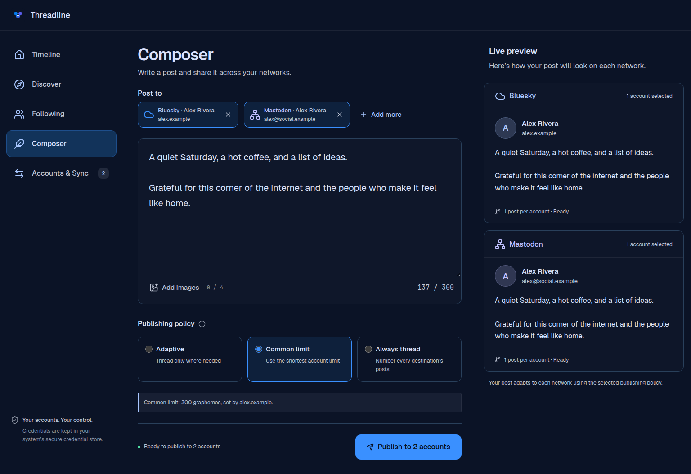
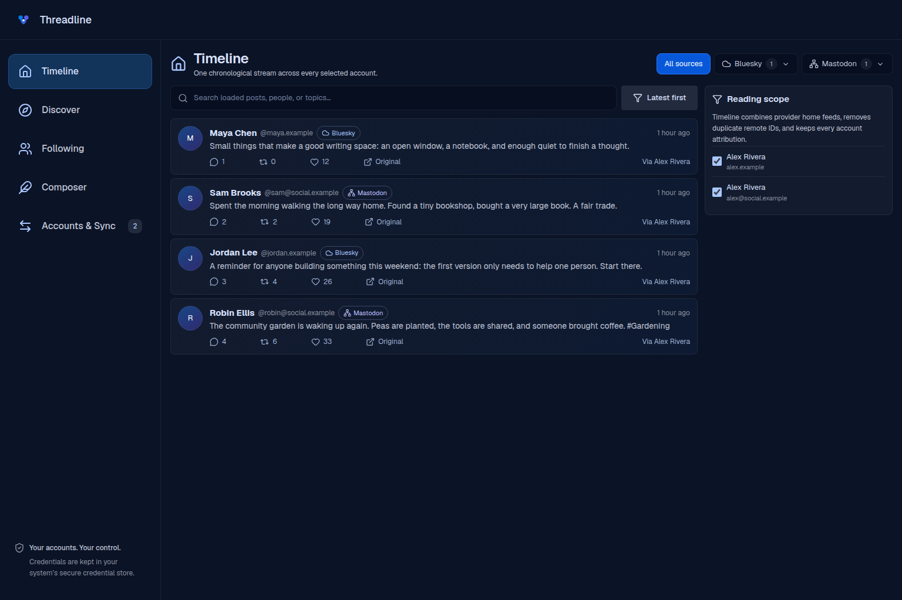
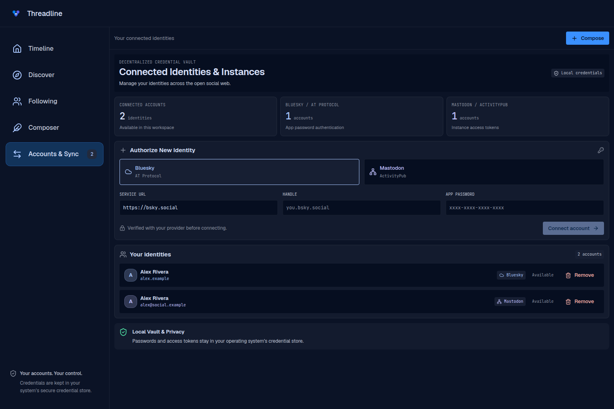

# Threadline

[](https://github.com/Shin-Aska/Threadline/releases/latest)
[](https://github.com/Shin-Aska/Threadline/actions/workflows/ci.yml)
[](LICENSE)

A modern, privacy-focused desktop client for **Bluesky** and **Mastodon**. Read your feeds together in a unified workspace, compose a single post, preview platform-specific adaptations, and cross-publish with complete control.



---

## ✨ Features

### 🌐 Unified Timelines & Multi-Account Browsing
- **Combined Home Timeline**: Browse posts from Bluesky and Mastodon in a unified stream, complete with clear account and network attribution.
- **Account Filtering**: Filter views to specific accounts or explore all connected identities simultaneously.
- **Full Social Navigation**: Seamlessly navigate profiles, replies, threads, hashtags, followed feeds, and discovery views.
- **Unread Notification Center**: Real-time badge indicators for unread notifications across all active accounts, with filtering and read-state management.
- **Safe External Browsing**: Links to external articles and web pages open securely in your default desktop browser.

### ✍️ Intelligent Cross-Posting Composer
- **Per-Network Previews**: Review how your post will render on Bluesky and Mastodon before publishing.
- **Smart Thread Splitting**: Automatically splits long-form content across multiple posts according to each network's character limits (adaptive, common limit, or numbered).
- **Rich Media Support**: Attach up to four images (JPEG, PNG, WebP) with custom alt text, or MP4 video with platform-aware limits.
- **Hashtag Suggestions**: Inline autocomplete recommendations as you type.
- **Per-Destination Results**: Live publication feedback detailing successes, partial outcomes, or specific provider errors.

### 🔒 Privacy & Local-First Architecture
- **OS Keychain Integration**: Account passwords, access tokens, and OAuth credentials are saved exclusively in your operating system's secure credential store.
- **Local SQLite Database**: Drafts, media attachments, and publishing history stay on your local disk. No third-party servers, intermediate brokers, or telemetry.
- **Local Scheduling**: Schedule posts to dispatch automatically while the app is running, with grace-period safeguards so late posts are never published silently.
- **Cache & Storage Management**: View disk cache usage, configure in-memory post retention budgets, and safely clear webview cache directly from Settings.

---

## 🖥️ Workspace Overview

The Threadline interface provides dedicated views for your daily workflow:

| View | Description |
| --- | --- |
| **Timeline** | Combined chronological feed with source badges and account filters. |
| **Notifications** | Centralized notification stream with unread counters and badge indicators. |
| **My profiles** | Inspect your public profiles, follower counts, and posts per account. |
| **Discover** | Explore trending feeds, suggested content, and remote hashtags. |
| **Following** | View followed people, lists, and curated feeds across platforms. |
| **Composer** | Rich drafting environment with thread splitting, media uploads, and live previews. |
| **Accounts & Sync** | Connect and manage Bluesky and Mastodon identities. |
| **Settings** | Adjust post retention limits, manage webview cache, and review app diagnostics. |

<details>
<summary>View Screenshots</summary>

### Timeline


### Accounts & Sync


</details>

---

## 📦 Downloads & Installation

Official installers are compiled and attested via GitHub Actions:

- **Windows**: [`.exe` installer / `.msi`](https://github.com/Shin-Aska/Threadline/releases/latest) (x86_64)
- **macOS**: [`.dmg` package](https://github.com/Shin-Aska/Threadline/releases/latest) (Apple Silicon `aarch64` & Intel `x86_64`)
- **Linux**: [`.AppImage` / `.deb`](https://github.com/Shin-Aska/Threadline/releases/latest) (x86_64)

Every official release includes SHA-256 checksums and cryptographic build provenance attestations. You can verify any downloaded artifact using the [GitHub CLI](https://cli.github.com/):

```bash
gh attestation verify ./YOUR_DOWNLOADED_FILE --repo Shin-Aska/Threadline \
  --signer-workflow Shin-Aska/Threadline/.github/workflows/release.yml \
  --deny-self-hosted-runners
```

---

## 🚀 Quick Start

1. Download and run Threadline for your operating system.
2. On first launch, connect your accounts:
   - **Bluesky**: Sign in using your handle and an [App Password](https://bsky.app/settings/app-passwords) (or browser OAuth where supported).
   - **Mastodon**: Enter your instance URL (e.g. `https://mastodon.social`) and authorize via browser OAuth or an access token.
3. Your combined timeline will automatically populate once connected.

---

## 🛠️ Building from Source

### Prerequisites
- [Node.js](https://nodejs.org/) (v22+ or v24 recommended) & npm
- [Rust](https://rustup.rs/) (stable toolchain)
- Platform-specific build tools ([Tauri Prerequisites Guide](https://v2.tauri.app/start/prerequisites/))

### Development Setup

```bash
# Clone the repository
git clone https://github.com/Shin-Aska/Threadline.git
cd Threadline

# Install frontend dependencies
npm ci

# Launch desktop app in development mode
npm run tauri:dev
```

For frontend UI iteration without the native backend:
```bash
npm run dev
# Opens at http://localhost:1420
```

---

## 📚 Technical Documentation

For in-depth architectural and developer documentation, explore:

- [Development Guide & Environment Setup](docs/development.md)
- [Release Process & Provenance Verification](docs/releases.md)
- [Architecture & Lifecycle](docs/architecture.md)
- [Publishing Engine, History & Scheduling](docs/publishing.md)
- [Provider Contracts & OAuth Implementation](docs/providers.md)
- [Visual Design System](DESIGN.md)

---

## ⚙️ Tech Stack

- **Framework**: [Tauri 2](https://v2.tauri.app/)
- **Core Backend**: [Rust](https://www.rust-lang.org/)
- **Frontend**: [React 19](https://react.dev/), [TypeScript](https://www.typescriptlang.org/), [Vite](https://vite.dev/)
- **Local Storage**: [SQLite](https://www.sqlite.org/) (via `rusqlite`), OS Credential Store (via `keyring`)

---

## 📄 License

Threadline is free and open-source software licensed under the [GNU General Public License v3.0](LICENSE).
