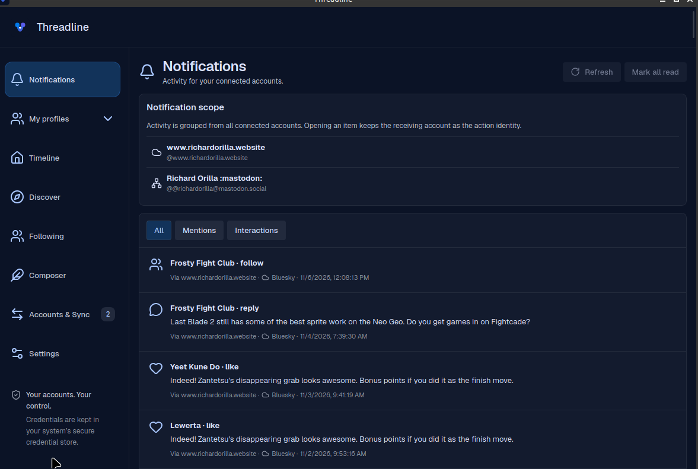
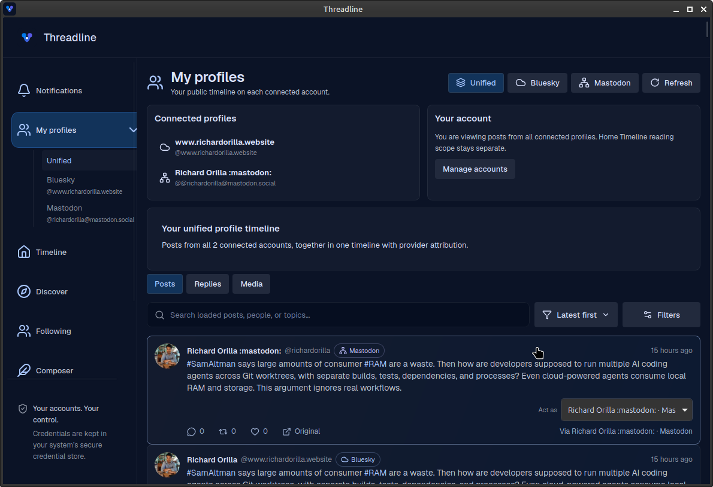
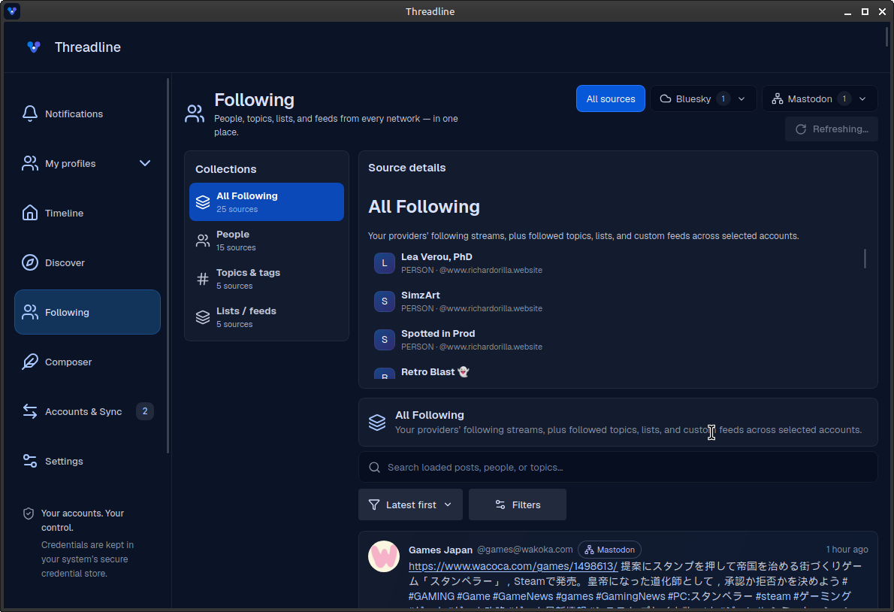

Threadline v1.1.0 makes your multi-account workspace easier to keep current, improves notification read handling, and updates frontend and native security dependencies.

## Highlights

- **Refresh across your workspace:** Notifications, My profiles, Timeline, Discover, and Following can fetch fresh data on demand. Your selected account scope, search, sorting, and filters stay in place.
- **Fresh unified profiles:** Returning to My profiles or switching back to Unified reloads posts from your connected accounts. You no longer need to visit each network first to see recent posts.
- **Reliable notification read state:** Successful Bluesky “Mark all read” responses no longer produce an error. Read actions, refresh, and pagination are coordinated; partial provider failures preserve successful results and remain available to retry.
- **Security maintenance:** Updates vulnerable frontend, TLS, runtime, and OAuth crypto dependencies; adds an explicit webview Content Security Policy; and introduces automated dependency audits and update checks.

## Release in pictures

These are original screenshots from the desktop app. The captions highlight the changes; the screenshots themselves are unchanged.

### Notifications: refresh and manage read state

Refresh connected-account activity without leaving Notifications. Mark-all-read actions show pending state and preserve successful updates when another provider needs a retry.



### My profiles: keep Unified up to date

See posts from your connected profiles together. Refresh manually or return to the view to fetch recent posts while retaining your chosen scope and filters.



### Following: fresh data, familiar context

Refresh followed people, topics, lists, and feeds while keeping your selected collection, account scope, and browsing filters. The screenshot shows a refresh in progress.



## Security and compatibility

The Bluesky OAuth crypto update preserves the existing saved-session and key format. Both npm and Rust dependency audits pass without advisory exceptions. Upstream informational maintenance and unsoundness warnings remain documented in the development guide.

Validation covers 116 controlled-browser tests and 140 Rust tests, including saved-key compatibility, independently verified OAuth signatures, notification recovery, retained refresh filters, and the production webview policy.

## Downloads

Choose `linux-x86_64` (AppImage or Debian package), `windows-x86_64` (EXE or MSI), or the macOS DMG for Apple Silicon (`aarch64`) or Intel (`x86_64`).

These installers are built by GitHub Actions and include SHA-256 checksums and build provenance attestations. Verify a downloaded installer with:

```bash
gh attestation verify ./YOUR_DOWNLOADED_FILE --repo Shin-Aska/Threadline \
  --signer-workflow Shin-Aska/Threadline/.github/workflows/release.yml \
  --source-ref refs/tags/v1.1.0 --deny-self-hosted-runners
```

Windows installers are not publisher-signed, and macOS builds are not Apple-notarized. OS security prompts may appear. GitHub provenance verification does not replace platform code signing.

## Current limits

Scheduling runs only while the desktop app is open. Provider availability, media limits, and remote outcomes remain provider-dependent. Packaged Bluesky browser OAuth requires a publicly hosted HTTPS client-metadata document; use app passwords when packaged OAuth is unavailable.

Full changelog: [v1.0.1...v1.1.0](https://github.com/Shin-Aska/Threadline/compare/v1.0.1...v1.1.0).
